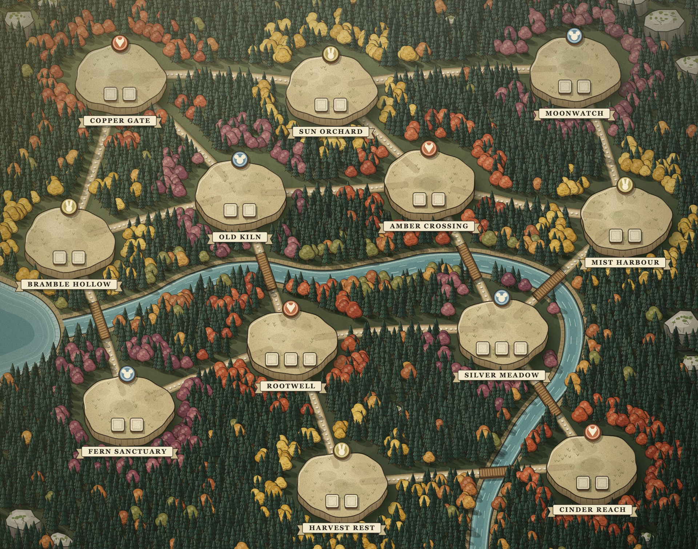

# Hệ thống bản đồ

Mỗi bản đồ là **một file** `maps/<id>.json`. Engine Python đọc phần gameplay, renderer web đọc toàn bộ. Không có dữ liệu bản đồ nào nằm rải trong mã nguồn.

Quy tắc thiết kế (đánh số clearing, ô đất xây, Rune, lối đi, phong cách, ràng buộc luật) nằm ở [MAP_DESIGN.md](MAP_DESIGN.md).

## Cấu trúc file

| Trường | Ai đọc | Ý nghĩa |
|---|---|---|
| `id`, `name` | cả hai | Khoá đăng ký và tên hiển thị. |
| `season` | web | Chọn bảng màu trong `web/src/map/palettes.ts` (hiện có `autumn`). |
| `seed` | web | Seed cố định cho rừng, vân đất, độ cong đường. Cùng seed thì cùng hình. |
| `size` | web | Khung toạ độ, hiện là `960 × 755`. Mọi toạ độ khác đều theo khung này. |
| `background` | web | Tuỳ chọn. Tên ảnh minh họa trong `maps/` (vd. `lakeside.webp`). Khi có, renderer vẽ nguyên ảnh làm nền thay cho địa hình tự sinh và chỉ phủ các lô đất trống (nền sỏi đá nâng, hàng rào gỗ thưa, vùng đất nện quanh lô; vẽ theo chiều sâu như phần còn lại của bản đồ) và huy hiệu suit, không vẽ tên; `terrain` khi đó chỉ dùng cho kiểm tra. |
| `plotSize` | web | Tuỳ chọn. Cạnh mỗi lô đất trống, mặc định `SLOT.size`. |
| `clearings[]` | cả hai | `name`, `suit`, `slots`, `x`, `y`, `paths` (chỉ số clearing kề, phải hai chiều). Tuỳ chọn `plots`: toạ độ tâm từng lô đất (đúng `slots` lô), đặt trên khoảng cỏ trống của ảnh để không che nhà; quân công trình được đặt đúng lên các lô này. Tuỳ chọn `ruin: true`: clearing bắt đầu với một ruin (tàn tích) nằm trên lô cuối cùng; ruin chiếm một slot cho tới khi bị khám phá, sau đó lô ấy mới xây được. Engine phát bốn item ruin vào đúng các clearing này, nên bản đồ phải đánh dấu đúng bốn ruin. |
| `forests[]` | engine | Các nhóm clearing bao quanh một khu rừng. |
| `terrain.treeSpacing` | web | Khoảng lưới đặt cây; nhỏ hơn thì rừng dày hơn. |
| `terrain.rivers[]` | web | `width` và các điểm điều khiển; đường cong Catmull-Rom đi qua từng điểm. |
| `terrain.lakes[]` | web | Đa giác khép kín (được làm mềm); được phép tràn ra ngoài khung. |
| `terrain.rocks[]` | web | `x`, `y`, `r`; cụm đá lớn ở mép tạo vách. |

Cầu được **tự sinh** ở mọi chỗ đường đi cắt sông. Cây được **tự đặt**: lá kim làm nền, cây lá màu theo suit bao quanh clearing, cây lá màu lẫn ven sông.

## Phong cách vẽ

Minh họa mực vẽ tay in trên giấy: mọi viền (bờ sông, bờ hồ, clearing) được vẽ hai lần bằng nét hơi run; mép đất, bờ nước và thành đá có nét gạch bóng; đường đi là dải đất với một hàng chấm sáng ở giữa; nền rừng có chấm mực; cuối cùng phủ một lớp màu giấy và vân giấy mịn.

## Cách renderer tạo chiều sâu

`web/src/map/paint.ts` vẽ một lần lên Canvas 2D ở đúng mật độ điểm ảnh của màn hình, rồi dùng làm texture nền cho PixiJS. Thứ tự lớp:

1. Nền rừng có vân và đốm sáng tối.
2. Đường đất: bóng, mép đất tối, mặt đất sáng, viền mực mảnh và hàng chấm sáng ở giữa.
3. Nước: bờ, dải nước nông sáng, lòng sâu, gợn sóng; bờ gần đổ bóng xuống mặt nước.
4. Cầu gỗ có bóng đổ trên nước.
5. **Sắp theo chiều sâu (y)**: cây, đá, cao nguyên clearing. Vật ở dưới che vật ở trên, tạo cảm giác 2.5D.
6. Ánh sáng chung: nguồn sáng từ góc trên trái, sương nhẹ phía xa (trên), vignette.
7. Biểu tượng suit và băng tên, luôn nằm trên cùng để dễ đọc.

Quân cờ và công trình là lớp PixiJS động trong `web/src/Board.tsx`. Kích thước cao nguyên và vị trí ô công trình dùng chung hằng số `PLATEAU`/`SLOT` trong `web/src/map/layout.ts`.

## Quy trình làm bản đồ mới

1. Tạo `maps/<id>.json`. Đặt clearing trước, nối `paths`, khai báo `forests`.
2. Thêm sông, hồ, đá theo bố cục mong muốn.
3. Đăng ký map trong `web/src/map/spec.ts` (`MAPS`; map có `background` thì import ảnh bằng `?url`), và đặt `ACTIVE_MAP` nếu muốn bàn chơi dùng map đó. Nếu map dùng mùa mới, thêm bảng màu vào `palettes.ts`.
4. Chạy `cd web && npm test`. Bài kiểm tra `map.test.ts` chạy `validateLayout` cho mọi map. Nó báo lỗi khi:
   - clearing chồng nhau;
   - đường đi không hai chiều, cắt nhau, hoặc chạy xuyên clearing khác;
   - sông, hồ hoặc đá chạm clearing hay chắn đường.
5. Xem trước không cần trận đấu: `cd web && npm run dev`, mở `http://127.0.0.1:5173/map-preview.html?map=<id>&scale=2`. Lỗi bố cục (nếu có) hiện ở đầu trang.
6. Để engine dùng map mới, đổi `MAP_ID` trong `backend/root/content.py`. Đổi `paths`/`forests` làm thay đổi gameplay, nên dữ liệu đánh giá và checkpoint cũ không còn so sánh được.
   - Chỉ dời `x`/`y` thì luật chơi không đổi, nhưng toạ độ nằm trong trạng thái được băm (`Game.digest`), nên các trận đã lưu trước đó sẽ không `verify` lại được.
7. Cập nhật ảnh trong `docs/maps/`.

## Bản đồ 3D (Three.js)

`web/src/map3d/` dựng lại bản đồ có ảnh minh họa (hiện là `lakeside`) thành cảnh Three.js:

- **Đọc ảnh** (`sample.ts`): chia ảnh thành ô 4 px và phân loại màu thành nước, đường đất, cỏ, rừng thông, cây lá, cây mùa thu, đá. Thuyền, bến và bóng của chúng trên mặt hồ được trả lại thành nước.
- **Địa hình**: lòng hồ trũng, đường đất hơi lún, nền rừng hơi gồ; màu đỉnh lấy theo loại đất, có dải cát ven bờ. Nước là shader riêng: nông sáng ở bờ, viền bọt, vệt sóng trôi chậm.
- **Cây và đá** được rải theo đúng vùng màu của ảnh (seed cố định); cây lá lấy màu từ chính ảnh. Mọi vật thể dùng cel-shading và viền mực.
- **Đường đi** (`routes.ts`): mỗi `paths` giữa hai clearing được dò theo đường đất đã vẽ trong ảnh (tìm đường rẻ nhất trên lưới: đường đất rẻ, cỏ đắt hơn, rừng rất đắt, hồ gần như cấm), làm mượt rồi vẽ thành dải đất sáng có viền mực và hàng đá lát ở giữa. Cây không mọc trên đường. Chỉ những đường này mới là lối di chuyển hợp lệ; đường đất khác trong ảnh chỉ là trang trí.
- **Nhà, bến, thuyền, khúc gỗ** đặt tay trong `maps/lakeside.scene.json` (cùng hệ toạ độ pixel với ảnh). Lô đất (`plots`) và huy hiệu suit lấy từ `maps/lakeside.json`.

Xem trước: `cd web && npm run dev`, mở `http://127.0.0.1:5173/map3d.html?map=lakeside`. Kéo để xoay, cuộn để zoom. `&debug=classes` tô địa hình theo loại đất đọc từ ảnh, `&debug=height` theo độ cao. `&labels=1` hiện số thứ tự clearing (số = vị trí trong `clearings` + 1, ảnh `docs/maps/lakeside-3d-numbered.jpg`).
